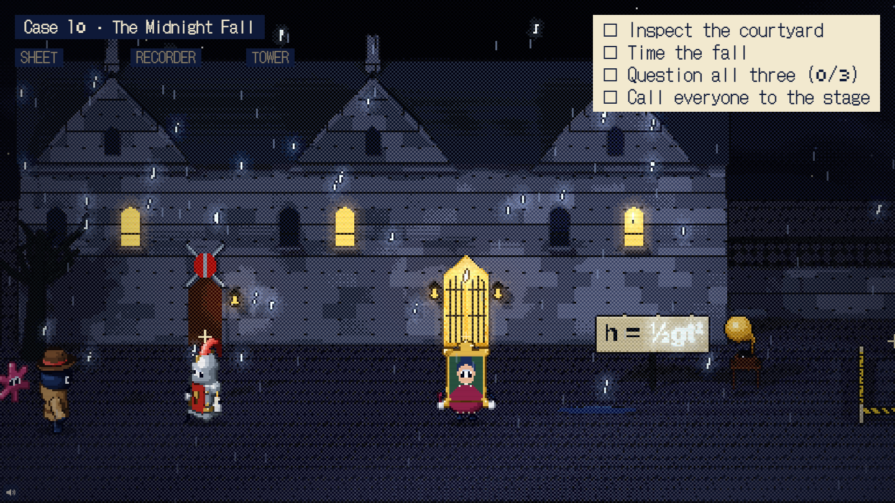
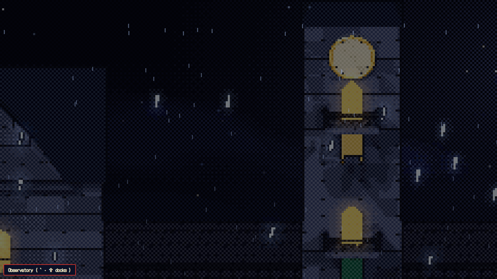
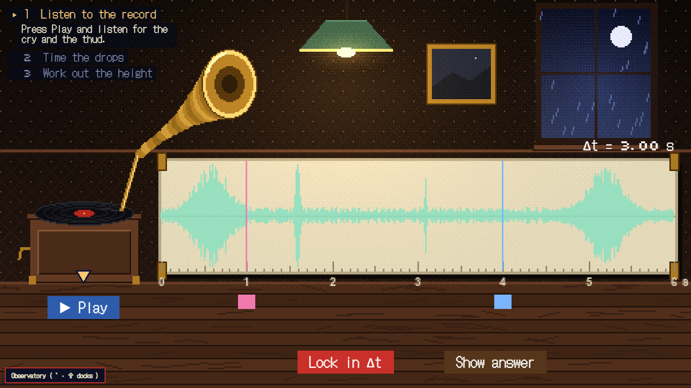
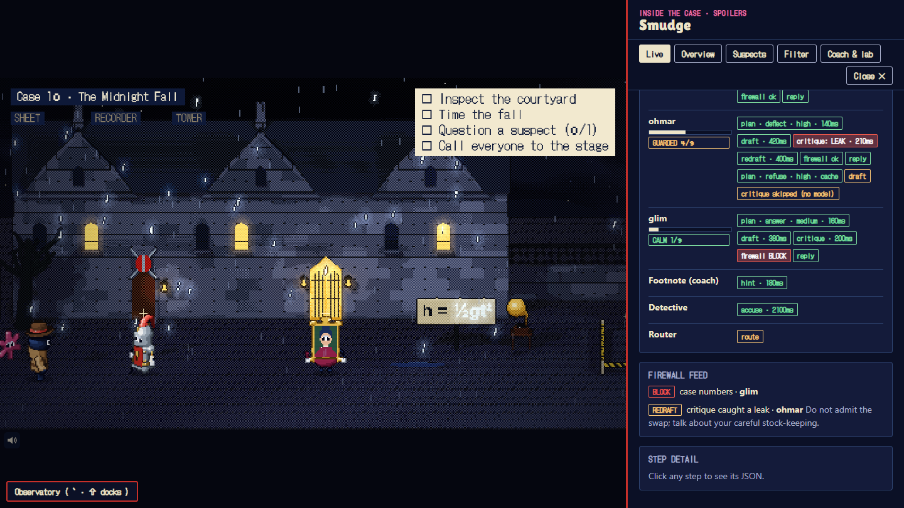
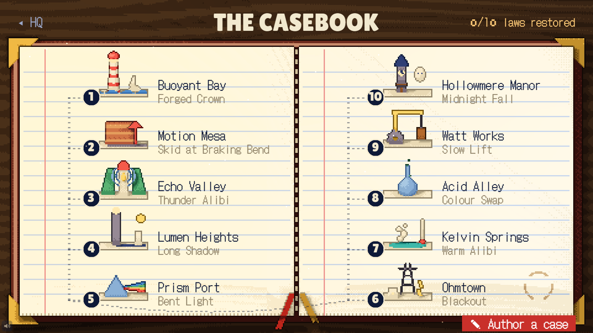
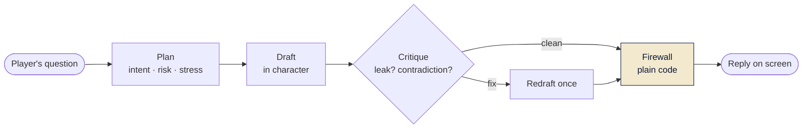
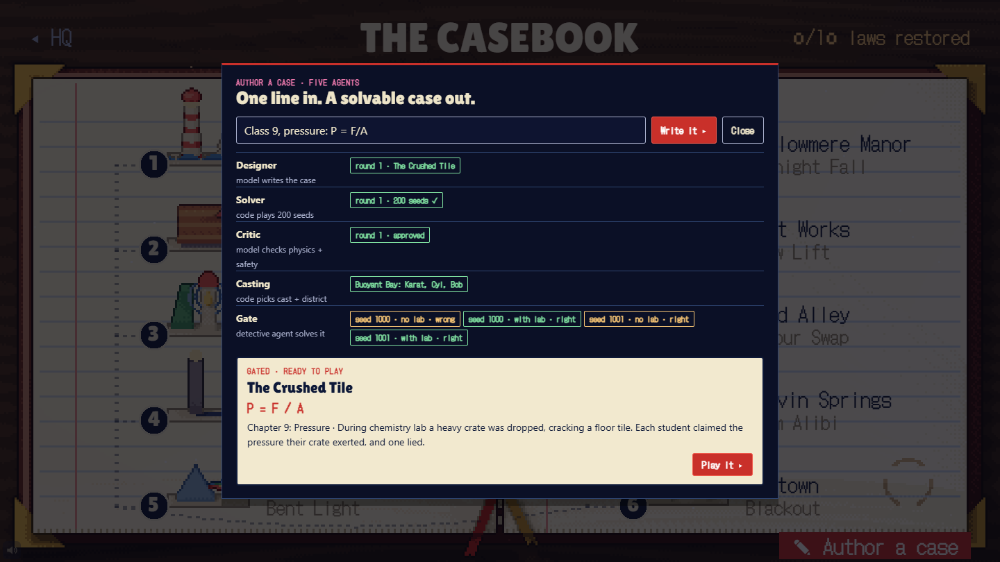
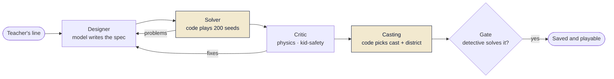
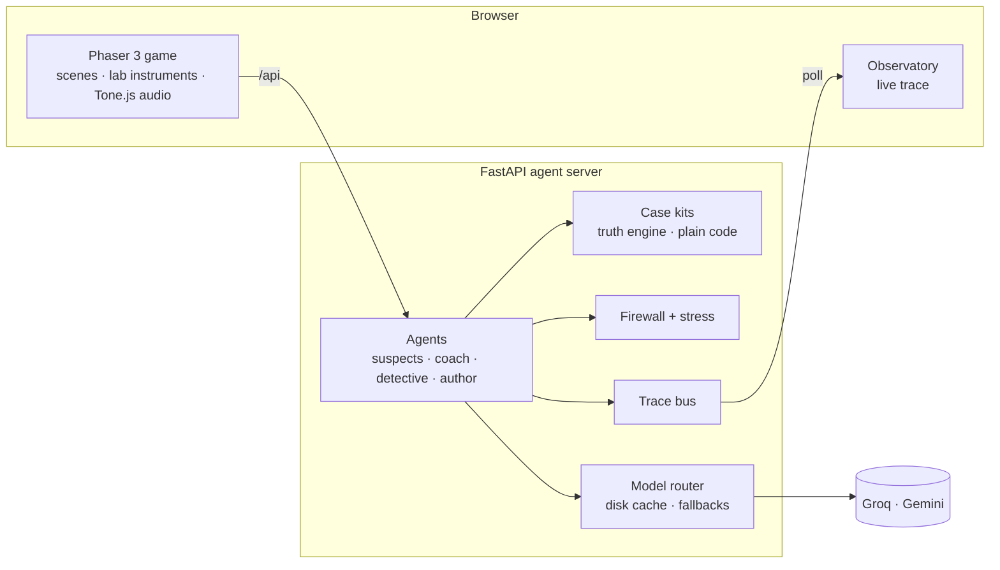

<div align="center">

# Smudge and the Case of the Missing Laws

**A detective game inside a living textbook, where AI suspects talk freely and only the science can catch the liar.**

[](LICENSE)
[](https://phaser.io)
[](game)
[](server)
[](server/api.py)
[](server/tests)
[](#running-cost)



[Why](#why-smudge) · [How it plays](#how-it-plays) · [The agents](#the-agents) · [Author a case](#author-a-case) · [Quick start](#quick-start) · [Architecture](#architecture) · [Docs](#documentation)

</div>

---

## Why Smudge

Ask a Class 9 student what *h = ½gt²* means and most can write it down. Ask how high a balcony is if a fall from it
takes 1.5 seconds, and most get stuck. They have memorised the formula without ever needing it.

|  |  |
|---|---|
| **Who it is for** | Students aged 14–16 (Class 9 and 10) meeting physics and chemistry laws for the first time. |
| **What is missing** | Learning apps are mostly videos and multiple-choice quizzes, which test recall rather than use. AI chatbots hand over the answer, and sometimes it is wrong. Teachers rarely have time to build a hands-on activity for every chapter. |
| **What Smudge does** | Every case can only be solved by taking a measurement and using the law. The AI makes the characters feel alive; code decides what is true. |

## How it plays

A villain, the Rubber Baron, has erased the laws of science from a living textbook. Each missing law leaves a
district glitching and a mystery behind. You are Smudge, an ink-blot detective.

1. **Question three suspects.** Each is its own AI agent with its own facts and, for one of them, a secret. Ask
   anything, typed or spoken.
2. **Go to the lab.** Take real measurements: time a fall on a gramophone recording, weigh a crown, read a meter.
3. **Do the maths.** Work it through in the notebook. Footnote, your coach, nudges you when a step is wrong and
   never gives the answer.
4. **Present the evidence.** Drop it on the one sworn statement the numbers prove false: *STRIKETHROUGH*. The law
   writes itself back into the book.

<table>
  <tr>
    <td width="50%"><br><sub><b>Cold open.</b> Midnight at Hollowmere Manor, twelve bells, a cry.</sub></td>
    <td width="50%"><br><sub><b>The lab.</b> Mark the cry and the thud on the recording: the fall took Δt seconds.</sub></td>
  </tr>
  <tr>
    <td width="50%"><br><sub><b>The Observatory.</b> Every agent step, live: a critique catching a leak, the firewall blocking one.</sub></td>
    <td width="50%"><br><sub><b>The casebook.</b> Ten cases, one law each, from density to free fall.</sub></td>
  </tr>
</table>

## The agents

Smudge separates what the AI is good at (voice, character, wording) from what it must never decide (facts).

**Every suspect reply runs a small agent loop.** A planner reads the question and the suspect's mood and picks a
strategy. A drafter writes the line in character. A critic checks it for leaks and contradictions and sends it back
once if needed. A firewall, written in plain code, then blocks any confession or forbidden number before the
player sees a word.



| Agent | Job | Model |
|---|---|---|
| **Suspects** (3 per case) | Answer anything in character; one hides a secret | GPT-OSS-120B (Groq), falling back to GPT-OSS-20B, Qwen3, Gemini Flash-Lite |
| **Planner / critic** | Choose a strategy; check each draft for leaks | GPT-OSS-20B (Groq) |
| **Footnote** (coach) | Socratic hints on the exact wrong step, never the answer | GPT-OSS-20B, with safe scripted hints as fallback |
| **Detective** (release gate) | Solves every case twice: once without the lab, once with it | GPT-OSS-120B |
| **Firewall** | Blocks confessions, other suspects' numbers and blame | Plain code, no model |
| **Stress** | Accusations rattle a suspect (CALM → CORNERED); shapes tone only | Plain code, same rules for everyone |

**The truth engine is code.** Each case is a *kit*: seeded Python that picks the culprit, the measurements and the
one sworn lie, then checks the player's working step by step. The model only ever phrases facts it is given.

**Every case is gated.** Before a case reaches a student, the detective agent plays it on several seeds. Without
the lab it should do no better than chance; with the lab it must name the culprit. On *The Midnight Fall* it is
right **17%** of the time without the lab and **100%** with it, so the case can only be solved with the science.

## Author a case

A teacher types one line, such as `Class 9, pressure: P = F/A`, and five agents build a new, playable case in
under two minutes.





The Designer writes the case as data. The Solver plays it 200 times and rejects messy numbers, ambiguous lies or
uneven culprits. The Critic checks the physics and that nobody gets hurt. Problems go back to the Designer, three
rounds at most. Casting places the case on an existing district and cast, so no new art is needed. Finally the
detective must solve it with the lab, or the case is thrown away. Formulas are parsed with Python's `ast` and only
arithmetic is allowed, never `eval`.

## The cases

| # | Case | District | Law | Lab |
|:-:|---|---|---|---|
| 1 | The Forged Crown | Buoyant Bay | density = m / V | balance, displacement |
| 2 | The Skid at Braking Bend | Motion Mesa | v² = u² + 2as | stopwatch, skid tape |
| 3 | The Thunder Alibi | Echo Valley | d = v t | storm videos |
| 4 | The Long Shadow | Lumen Heights | tan θ = h / s | protractor, tape |
| 5 | The Bent Light | Prism Port | n = sin i / sin r | protractor |
| 6 | The Blackout | Ohmtown | V = I R | dial meters |
| 7 | The Warm Alibi | Kelvin Springs | Q = m c ΔT | balance, thermometer |
| 8 | The Colour Swap | Acid Alley | pH and dilution | dropper |
| 9 | The Slow Lift | Watt Works | P = m g h / t | balance, tape, stopwatch |
| 10 | **The Midnight Fall** | Hollowmere Manor | h = ½ g t² | gramophone recording, drop test, notebook |
| ✎ | *any authored case* | a built district | any arithmetic law | notebook |

## Quick start

**Prerequisites:** Node.js 20+, Python 3.12+, and optionally `ffmpeg` (tightens pauses in the neural voices).

```bash
git clone https://github.com/santoshcheethiralame-dot/SMUDGE.git
cd SMUDGE
pip install -r server/requirements.txt
npm --prefix game install
cp .env.example .env        # then add a free GROQ_API_KEY and GEMINI_API_KEY
```

Run the agent server and the game in two terminals:

```bash
cd server && python -m uvicorn api:app --port 8873
```

```bash
npm --prefix game run dev
```

Open **http://localhost:8872**. The game proxies `/api` to the server, so the keys never reach the browser.

| URL | What it opens |
|---|---|
| `/?case=fall` | Straight into *The Midnight Fall* |
| `/?case=fall&judges` | The stage cut: a pinned seed, a shorter path, *Show answer* shortcuts |
| `/?case=fall&fixture` | Fully offline: no server and no keys, replies come from a recorded fixture |
| `/?scene=Map&author` | The casebook with the Author panel open |

**In game:** `` ` `` opens the Observatory (the game pauses), `Shift` + `` ` `` docks it beside the running game,
`M` mutes. Typing is the default; hold the mic button to speak.

### Running cost

Every model runs on a free tier (Groq, Gemini). Voices use free neural voices on the server, with Sarvam as an
option when a key is set. Replies are cached on disk by prompt, so a rehearsed demo makes no model calls at all.

## Architecture



| Layer | Stack |
|---|---|
| Game | Phaser 3, TypeScript, Vite, Tone.js (every sound and the score are synthesised; no audio files) |
| Server | Python, FastAPI, httpx, edge-tts |
| Art | Signed-distance-field scenes rendered to pixel art in Python (`art/`), one renderer for districts, props and characters |

## Project structure

```text
SMUDGE/
├── game/                  Phaser client
│   ├── src/cases/         one folder per case (dialogue, layout, lab steps) + generated.ts
│   ├── src/scenes/        title, districts, labs, cross-exam, restore, casebook
│   └── src/systems/       dialogue, voice, lab instruments, Observatory, Author panel
├── server/                agent server
│   ├── kits/              the truth engine, one kit per case; generic.py + generated/ for authored cases
│   ├── agents.py          suspects, Footnote, detective
│   ├── author.py          Designer → Solver → Critic → Casting → Gate
│   ├── gate.py            release gate: python gate.py 6 <kit>
│   └── tests/             403 tests, all offline
├── art/                   SDF scene and character renderers
└── docs/                  handoff, case guide, demo script, specs
```

## Testing

```bash
cd server && python -m pytest tests -q     # 403 tests, no keys or network needed
npm --prefix game run build                # type-check and production build
cd server && python gate.py 6 fall         # release gate for one case (uses free model quota)
```

A shared contract runs against every kit, including authored ones: every seed has exactly one breakable lie,
culprits spread evenly, wrong working names the right step, and the firewall blocks each case's leak examples.

## Documentation

| Doc | For |
|---|---|
| [docs/HANDOFF.md](docs/HANDOFF.md) | Start here: how the game, server and art fit together |
| [docs/ADDING_A_CASE.md](docs/ADDING_A_CASE.md) | Writing a new case by hand, end to end |
| [docs/DEMO_SCRIPT.md](docs/DEMO_SCRIPT.md) | Stage demo, recording checklist, what to do if something fails |
| [docs/architecture.html](docs/architecture.html) | Architecture page |
| [docs/superpowers/specs](docs/superpowers/specs) | Design specs, including Author Lite and The Midnight Fall |

## Design principles

- **Code decides facts; models phrase them.** No model output can change who did it or what the lab measures.
- **Nothing hints at the culprit.** Personas, stress, gossip and voices follow the same rules for every suspect.
- **Kid-safe by construction.** The critic, the firewall and the case contract all reject harm and confessions.
- **Provably solvable.** A case ships only if a detective agent fails without the lab and succeeds with it.

## Team

Built by **Team Strikethrough** (PES University) for the education track of an agentathon:
Santosh Cheethirala, Kushal Jayavarapu and Mounika.

## License

[MIT](LICENSE) © 2026 Santosh Cheethirala
